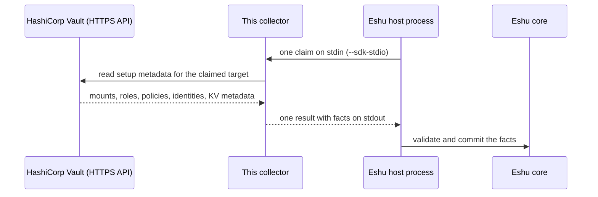

# eshu-collector-vault-live

**Status: pre-release.** Eshu core still owns this data in production.
This repo has no authority to publish facts on its own yet.

This collector reads HashiCorp Vault setup metadata and hands Eshu
evidence about how Vault is configured, so you can answer which auth
methods, policies, identities, and secret engines a Vault cluster
has — without ever reading a secret value.

Vault is a system that stores secrets and controls who may read them.
A *fact* is one small, typed piece of evidence.
A *claim* is one bounded request to collect one Vault target.
The *host* is the Eshu process that starts this collector, sends it a
claim, and stores the result.
Evidence here is metadata only: how Vault is set up, never the
secrets it guards.
This collector only collects and returns evidence. It does not store anything itself and never changes Vault.

## What it collects

The table below is generated from `spec.emittedFacts` in
[manifest.yaml](manifest.yaml).
That file declares 8 fact kinds, all at schema version `1.0.0` with
`reported` confidence (Vault reported it).

| Fact kind | Plain meaning |
|---|---|
| `vault_auth_mount` | One enabled login method (auth mount) |
| `vault_auth_role` | One role under a login method |
| `vault_acl_policy` | One ACL policy: rules for who may do what |
| `vault_identity_entity` | One Vault identity (a who known to Vault) |
| `vault_identity_alias` | One link from a login identity to a Vault identity |
| `vault_kv_metadata` | Metadata about one key-value secret path, never its value |
| `vault_secret_engine_mount` | One enabled secrets engine |
| `secrets_iam_coverage_warning` | Part of the target could not be read fully |

ACL means access control list.
KV means Vault's key-value secrets engine.
The client refuses KV `/data/` reads, so no code path can read a
secret value.
Names and paths are fingerprinted with a keyed hash (HMAC — a
one-way fingerprint that needs a secret key) before emission, so
facts carry stable fingerprints instead of raw Vault names.

## How it fits in



In text: HashiCorp Vault -> this collector -> Eshu host process -> Eshu core. Collection is resilient per family: if one family cannot be read,
the rest still emit and the partial scope adds a
`secrets_iam_coverage_warning` fact.

## When to use it

Use it when Eshu needs evidence about how a Vault cluster is set
up: its auth mounts and roles, ACL policies, identity entities and
aliases, secrets engine mounts, and which KV paths exist.

## When not to use it

- Do not use it to read secret values. That is blocked by design.
- Do not use it to change Vault. It only reads metadata.
- Do not use it as a Vault browser for humans.
  It returns facts to the Eshu host; it has no user interface.
- Do not put a Vault token in config.
  Config with a token key is rejected; use `token_env` instead.

## How Eshu runs it

The host runs one claim per process invocation.
With no arguments (or `--sdk-stdio`) the binary reads one
`collector-sdk/v1alpha1` request from stdin and writes one result to
stdout.
Claims for any other collector kind or source system are rejected.
The host builds the core fact envelope, validates the result, and
owns claims and commits.

```bash
go run ./cmd/collector --sdk-stdio < request.json > result.json
```

The binary is also its own installer:

```bash
collector seed --dest DIR --image-ref ghcr.io/eshu-hq/eshu-collector-vault-live@sha256:<digest>
```

`seed` writes `DIR/collector` (this binary, mode `0755`) and
`DIR/manifest.yaml` (the embedded manifest).
Without `--image-ref`, `COLLECTOR_IMAGE_REF` supplies the reference.
An image cannot embed its own digest, so [manifest.yaml](manifest.yaml)
in this repo keeps the all-zero placeholder digest and deployments
stamp the real one at seed time.
The image entrypoint is `/usr/local/bin/collector` with default
argument `--sdk-stdio` (see [Dockerfile](Dockerfile)).

## Configuration

There is no `config.example.*` file in this repo.
The host request `config` object is the configuration, decoded by
`ParseSettings` in `config.go`.
Parse errors name config keys only and never quote a configured
value.

| Name | Required | Default | Meaning |
|---|---|---|---|
| `collector_instance_id` | Yes | None | Instance that owns target policy |
| `targets` | Yes, at least one | None | Vault targets this instance may collect |
| `targets[].vault_cluster_id` | Yes | None | Durable identity of one Vault cluster |
| `targets[].address` | Yes | None | Vault HTTPS address for the target |
| `targets[].token_env` | Yes | None | Name of the env var holding the read-only token |
| `targets[].namespace` | No | Empty | Vault namespace for the target |
| `targets[].display_name` | No | Empty | Operator-facing target label |
| `targets[].environment` | No | Empty | Operator-declared environment label |
| `targets[].source_uri` | No | Sanitized target address | Credential-free source address recorded on facts |
| `ESHU_VAULT_LIVE_REDACTION_KEY` (env) | Yes | None | Key material for name and path fingerprints |

Two targets with the same cluster and namespace are rejected.
Any target key containing `token` other than `token_env`, or naming
`secret`, `password`, `credential`, `api_key`, or `private_key`,
fails closed.
The token named by `token_env` must be present and non-empty in the
process environment at claim time.

## Credentials and least privilege

The read-only Vault token resolves from the environment variable
that `token_env` names; it never appears in claim config, facts,
logs, or metric labels.
The redaction key resolves from `ESHU_VAULT_LIVE_REDACTION_KEY` the
same way.
In code, the client reads only these Vault API families:
`sys/auth`, `sys/mounts`, `sys/policies/acl` (list and read),
`auth/<mount>/role` listings, `identity/entity/id`,
`identity/entity-alias/id`, and KV metadata paths.
Grant the token only the read and list access those metadata paths
need, and stop there.
This repo ships no Vault policy file, so do not copy a policy from
another repo without checking it against that list.
KV `/data/` reads are refused in the client, so the token needs no
access to secret values.

## Claim budget and operator signals

The transport caps one request at 1 MiB (`1 << 20` bytes) and one
result at 32 MiB (`32 << 20` bytes).
The claim deadline comes from the host request; an expired deadline
is a transport failure, not a served claim.
Each served claim writes one bounded JSON diagnostic line to stderr
with the `event` (`complete`, `failure`, `config_failure`, or
`unknown_scope`), `scope`, `generation`, and `latency_ms`.
The line never carries tokens, Vault addresses, raw Vault paths, or
upstream bodies.
The host's process runner keeps only a stderr byte count, so the
line helps local runs and tests more than production operators.
Exit code `0` means one claim was served, even when the result is
retryable or terminal; non-zero means transport failed (oversize
request, expired deadline, malformed JSON, foreign claim kind, or
usage error).
Retryable failures with no upstream `Retry-After` use a 60-second
default backoff.
The manifest declares metric prefix `eshu_dp_vault_live_collector_`
as declared only: the collector emits no metric under this prefix
and holds no telemetry handle.

## Eshu dependencies

| Dependency | Version or contract | Source |
|---|---|---|
| `github.com/eshu-hq/eshu-sdk/collector` | `v0.1.0-rc.4` | `go.mod` |
| `github.com/eshu-hq/eshu-sdk/factschema` | `v0.1.0-rc.7` | `go.mod` |
| Host protocol | `collector-sdk/v1alpha1`, `process` adapter | [manifest.yaml](manifest.yaml) |
| Eshu core compatibility | `>=0.0.5 <0.2.0` | [manifest.yaml](manifest.yaml) |
| Producer identity | `dev.eshu.collector.vault-live`, version `0.1.1` | [manifest.yaml](manifest.yaml) |

## What this never does

- It never writes to the Eshu graph, Postgres, or any queue.
  It holds no Postgres, graph, queue, lease, or workflow handle,
  and it never imports the Eshu core module.
- It never reads a KV secret value; `/data/` reads are refused.
- It never emits a raw Vault name or path; fingerprints replace them.
- It never accepts a token from config or logs one.
- It never changes Vault; every API call is a read or list.

## Build, test, and release

```bash
make ci
```

`make ci` runs `make lint`, `make test`, and `make race` (see
[Makefile](Makefile)): vet, lint and format checks, module drift,
no `replace` directives, the 500-line file cap, the full test
suite, and the race suite with the coverage floor read from CI.
Releases: tag `v<manifest version>` on the protected `main` head.
The release workflow refuses a tag on any other commit, publishes
`ghcr.io/eshu-hq/eshu-collector-vault-live` with build-provenance
and SBOM attestations, and reports the digest in the job summary.
Use a `v<manifest version>-*` prerelease tag (for example
`v0.1.0-qa.1`) for QA images.
Copy the published digest into the activation seed reference as
shown above; `scripts/pin-digest.sh` resolves a pushed tag to its
digest reference.

## Docs and related repos

- [manifest.yaml](manifest.yaml) — component identity, facts, and artifact slot
- [eshu](https://github.com/eshu-hq/eshu) — Eshu core
- [eshu-sdk](https://github.com/eshu-hq/eshu-sdk) — collector and fact-schema contracts
- [eshu-deploy](https://github.com/eshu-hq/eshu-deploy) — deployment charts and activations

## Contributing, security, and license

See [CONTRIBUTING.md](CONTRIBUTING.md) before opening a change.
There is no `SECURITY.md` in this repo.
Licensed under MIT; see [LICENSE](LICENSE).
