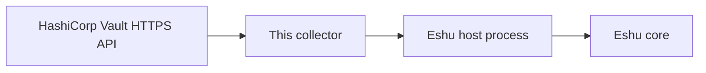

# eshu-collector-vault-live

**Status: pre-release.** Eshu core still owns this data in
production. This repo has no authority to publish facts on its own
yet.

In a nutshell: this collector reads HashiCorp Vault setup metadata
and hands Eshu evidence about how Vault is configured. Eshu can
then answer which auth methods, policies, identities, and secret
engines a Vault cluster has, without anyone ever reading a secret
value. The collector only collects and returns evidence; it
doesn't store anything itself and never changes Vault.

In text: HashiCorp Vault -> this collector -> Eshu host process ->
Eshu core.

## When to use it

Use it when Eshu needs evidence about how a Vault cluster is set
up: its auth mounts and roles, ACL policies, identity entities and
aliases, secrets engine mounts, and which KV paths exist.

## When not to use it

- Don't use it to read secret values. That is blocked by design.
- Don't use it to change Vault. It only reads metadata.
- Don't use it as a Vault browser for humans.
  It returns facts to the Eshu host; it has no user interface.
- Don't put a Vault token in config.
  Config with a token key is rejected; use `token_env` instead.

## How Eshu runs it

The host runs one claim per process invocation.
With no arguments (or `--sdk-stdio`) the binary reads one
`collector-sdk/v1alpha1` request from stdin and writes one result
to stdout. The host owns claims and commits; this binary never
commits facts itself.

## Documentation

Start at the [docs index](docs/README.md). Shortcuts people use most:

| Page | What you'll find there |
|---|---|
| [Getting started](docs/getting-started/README.md) | Run it once, see facts come back |
| [Configuration](docs/reference/configuration.md) | Every config field, credentials, and the claim budget |
| [Facts](docs/reference/facts.md) | The fact kinds it emits, mirroring the manifest |
| [Diagrams](docs/diagrams/README.md) | Every diagram, with captions and text versions |

## Related repos

- [eshu](https://github.com/eshu-hq/eshu), Eshu core
- [eshu-sdk](https://github.com/eshu-hq/eshu-sdk), collector and fact-schema contracts
- [eshu-deploy](https://github.com/eshu-hq/eshu-deploy), deployment charts and activations

## Development

Run `make ci` to check a change the way CI does.

## Contributing, security, and license

See [CONTRIBUTING.md](CONTRIBUTING.md) before opening a change.
There's no `SECURITY.md` in this repo.
Licensed under MIT; see [LICENSE](LICENSE).
